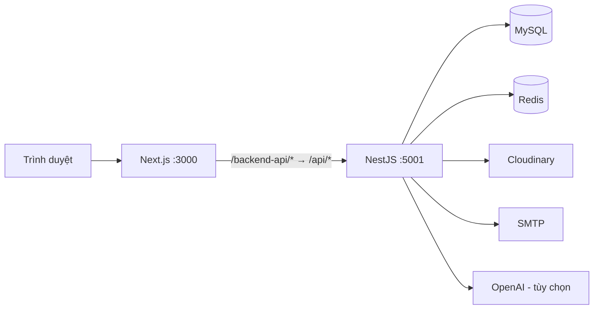

# OfficeFlow Helpdesk

Ứng dụng quản lý hỗ trợ IT nội bộ, kết hợp xử lý ticket, quản lý tài sản, kho kiến thức và nghỉ phép. OfficeFlow cung cấp giao diện theo vai trò để nhân viên gửi yêu cầu, đội IT theo dõi công việc và quản lý giám sát hoạt động trong phạm vi được cấp quyền.

## Chức năng

| Phân hệ | Chức năng chính |
| --- | --- |
| Ticket | Tạo yêu cầu, phân loại, đặt độ ưu tiên, giao người xử lý, bình luận, tệp đính kèm và lịch sử thay đổi. Người gửi xác nhận kết quả hoặc yêu cầu xử lý tiếp. |
| Hàng đợi IT | Xem việc của tôi, ticket chưa được giao, khối lượng công việc và giao tối đa 10 ticket mỗi lần. |
| SLA | Tính hạn theo giờ hành chính, cuối tuần và ngày nghỉ; cấu hình hạn phản hồi/xử lý, cảnh báo và chuyển cấp. |
| Kho kiến thức | Soạn và xuất bản hướng dẫn; gợi ý bài liên quan khi tạo ticket bằng tìm kiếm từ khóa. |
| Tài sản | Quản lý thiết bị, cấp phát/thu hồi, lịch sử sử dụng, bảo trì, sửa chữa và nhắc bảo hành. |
| Nghỉ phép | Gửi và duyệt đơn, nghỉ cả ngày/nửa ngày, hạn mức phép năm, số dư và lịch phòng ban. |
| Quản trị | Quản lý người dùng, phòng ban, danh mục ticket, khóa tài khoản, dashboard và nhật ký kiểm toán. |
| Thông báo | Thông báo trong ứng dụng và email qua SMTP; sự kiện nền dùng transactional outbox và retry. |
| AI hỗ trợ IT | Tóm tắt ticket, soạn phản hồi và soạn bài kiến thức cho ADMIN/IT_STAFF. Người dùng kiểm tra, chỉnh sửa và chủ động lưu/gửi bản nháp. |

Hệ thống có bốn vai trò: `ADMIN`, `MANAGER`, `IT_STAFF`, `EMPLOYEE`. Quyền truy cập còn phụ thuộc vào phòng ban, người tạo, người xử lý hoặc người duyệt của từng bản ghi; vai trò quản lý không đồng nghĩa với quyền đọc toàn bộ dữ liệu.

## Công nghệ và kiến trúc

| Thành phần | Công nghệ trong repository |
| --- | --- |
| Frontend | Next.js 16, React 19, TypeScript, Tailwind CSS 4, Radix UI, TanStack Query, React Hook Form và Zod |
| Backend | NestJS 11, TypeScript, REST API và Swagger/OpenAPI |
| Cơ sở dữ liệu | MySQL 8.4 trong Docker Compose, Prisma 7 và MariaDB driver adapter |
| Cache và giới hạn truy cập | Redis 8; dashboard cache và rate limiting |
| Xác thực | JWT access token, refresh token trong cookie HttpOnly, bcrypt và phân quyền phía backend |
| Dịch vụ tích hợp | Cloudinary cho tệp đính kèm, SMTP cho email, OpenAI cho trợ lý IT tùy chọn |
| Kiểm thử và vận hành | Jest, Supertest, Playwright, Docker Compose, GitHub Actions, Prometheus và Alertmanager |



Frontend mặc định gọi `/backend-api` trên cùng origin; Next.js chuyển tiếp tới backend qua `API_PROXY_TARGET`. Access token được giữ trong bộ nhớ frontend, còn refresh token dùng cookie HttpOnly. Redis gián đoạn sẽ khiến cache quay về đọc database và rate limiting dùng bộ nhớ từng instance; riêng tính năng AI cần Redis hoạt động.

## Cấu trúc thư mục

```text
.
├── officeflow-client/              # Giao diện Next.js
│   ├── src/app/                    # Trang đăng nhập và các trang nghiệp vụ
│   ├── src/components/             # Thành phần giao diện
│   ├── src/features/               # Màn hình, API, hooks và UI theo nghiệp vụ
│   ├── src/lib/                    # API client, session và tiện ích
│   └── tests/                      # Regression và kiểm thử trình duyệt
├── officeflow-nest-server/         # Backend NestJS
│   ├── src/modules/                # Các module nghiệp vụ
│   ├── src/platform/               # Redis, Cloudinary, metrics và outbox
│   ├── src/contracts/events/       # Hợp đồng sự kiện dùng giữa module
│   ├── src/prisma/                 # Schema, migrations và seed
│   ├── test/                       # HTTP E2E và integration tests
│   ├── monitoring/                 # Prometheus và Alertmanager
│   ├── scripts/                    # Kiểm thử, backup và công cụ database
│   └── docker-compose.yml          # MySQL, Redis và API
├── docs/features/                 # Quy tắc và API từng tính năng
├── docs/operations/               # Triển khai, migration, backup và rollback
├── scripts/                       # Kiểm tra dùng chung
└── .github/workflows/              # Backend CI/CD và frontend CI
```

## Chạy môi trường phát triển

### 1. Chuẩn bị

- Node.js **22.x**; backend khai báo `>=22 <23`.
- npm **12.2.0**, theo `packageManager` của hai ứng dụng và cấu hình CI.
- Docker Desktop với Docker Compose v2, đang chạy Linux containers.
- Các cổng mặc định còn trống: `3000` (web), `5001` (API), `3307` (MySQL), `6380` (Redis).

Các lệnh dưới đây dùng PowerShell, bắt đầu từ thư mục gốc repository. Hai ứng dụng cài dependencies riêng bằng `npm ci`; không có lệnh cài đặt chung ở thư mục gốc.

### 2. Cấu hình backend

```powershell
cd officeflow-nest-server
Copy-Item .env.example .env
npm ci
```

Chỉ sao chép khi chưa có `.env` để giữ cấu hình đang sử dụng. Chỉnh file vừa tạo:

| Biến | Cấu hình local |
| --- | --- |
| `NODE_ENV` | `development` |
| `PORT` | `5001` |
| `FRONTEND_URL` | `http://localhost:3000` |
| `MYSQL_ROOT_PASSWORD` | Mật khẩu riêng cho tài khoản root của MySQL Docker |
| `MYSQL_DATABASE` | `officeflow_helpdesk` |
| `MYSQL_USER`, `MYSQL_PASSWORD` | Tài khoản ứng dụng và mật khẩu MySQL |
| `DATABASE_URL` | `mysql://officeflow_user:<password>@localhost:3307/officeflow_helpdesk` khi API chạy trên máy |
| `DOCKER_DATABASE_URL` | `mysql://officeflow_user:<password>@mysql:3306/officeflow_helpdesk` khi API chạy trong Docker |
| `JWT_ACCESS_SECRET` | Chuỗi ngẫu nhiên dài ít nhất 32 byte |
| `REDIS_URL` | `redis://127.0.0.1:6380` |
| `MAIL_ENABLED` | Đổi thành `false` nếu chưa cấu hình SMTP; file mẫu đang để `true` |
| `AI_ENABLED` | Giữ `false` nếu chưa dùng AI |
| `SEED_DEFAULT_PASSWORD` | Mật khẩu cho tài khoản mẫu mới, ít nhất 12 ký tự và không bắt đầu bằng `replace-` |
| `METRICS_TOKEN` | Thêm vào `.env`: đúng 64 ký tự hex viết thường; Compose yêu cầu biến này dù file mẫu chưa có |

Mật khẩu trong hai URL phải khớp `MYSQL_PASSWORD`; mã hóa phần mật khẩu theo URL nếu chứa ký tự đặc biệt. Thay `<password>` bằng giá trị thực.

Sinh một giá trị ngẫu nhiên 64 ký tự hex bằng lệnh sau. Chạy riêng cho `JWT_ACCESS_SECRET` và `METRICS_TOKEN`, rồi dán từng kết quả vào `.env`:

```powershell
node -e "console.log(require('node:crypto').randomBytes(32).toString('hex'))"
```

### 3. Khởi động MySQL và Redis

Vẫn trong `officeflow-nest-server`, kiểm tra volume MySQL mà Compose sử dụng:

```powershell
docker volume inspect officeflowhelpdesk_officeflow_mysql_data
```

Compose khai báo volume này là **external**. Chỉ khi Docker báo volume chưa tồn tại và đang thiết lập database local mới, tạo nó:

```powershell
docker volume create officeflowhelpdesk_officeflow_mysql_data
```

Khởi động hai dịch vụ:

```powershell
docker compose up -d --wait mysql redis
docker compose ps
```

Nếu dùng volume đã có dữ liệu, giữ thông tin đăng nhập tương ứng. Đổi `MYSQL_*` trong `.env` không đổi mật khẩu hoặc tạo lại người dùng trong database đã khởi tạo.

### 4. Chuẩn bị database và chạy API

Vẫn trong `officeflow-nest-server`, xác nhận `DATABASE_URL` trỏ tới database local cần sử dụng, rồi chạy:

```powershell
npx prisma generate
npm run migrate:deploy
npm run prisma:seed
npm run start:dev
```

Seed phục vụ database phát triển với dữ liệu mẫu về người dùng, phòng ban, ticket, kiến thức và tài sản. Có thể bỏ qua seed nếu database đã có tài khoản sử dụng. Seed giữ mật khẩu người dùng đã tồn tại nhưng có cập nhật hồ sơ và dữ liệu mẫu; chỉ dùng trên database phát triển đã chọn. Giữ `ALLOW_PRODUCTION_SEED=0` và `ALLOW_REMOTE_SEED=0`.

### 5. Chạy frontend

Mở terminal thứ hai tại thư mục gốc repository:

```powershell
cd officeflow-client
Copy-Item .env.example .env.local
npm ci
npm run dev
```

Chỉ sao chép nếu chưa có `.env.local`. Cấu hình mẫu đã trỏ tới API local:

```dotenv
NEXT_PUBLIC_API_URL=/backend-api
NEXT_PUBLIC_API_TIMEOUT_MS=70000
API_PROXY_TARGET=http://localhost:5001/api
```

Khởi động lại frontend sau khi đổi cấu hình proxy.

### 6. Truy cập và đăng nhập

| Địa chỉ | Mục đích |
| --- | --- |
| http://localhost:3000/login | Đăng nhập ứng dụng |
| http://localhost:5001/api/docs | Swagger UI, chỉ bật khi `NODE_ENV` khác `production` |
| http://localhost:5001/api/health | Kiểm tra tiến trình API |
| http://localhost:5001/api/db-health | Kiểm tra kết nối database và các thành phần schema bắt buộc |

Sau khi seed database mới, có thể dùng:

| Vai trò | Email mẫu |
| --- | --- |
| ADMIN | `admin@officeflow.com` |
| MANAGER | `manager.it@officeflow.com` |
| IT_STAFF | `it.linh@officeflow.com` |
| EMPLOYEE | `employee.binh@officeflow.com` |

Mật khẩu của tài khoản mới là `SEED_DEFAULT_PASSWORD` đã đặt. Seed lại không đặt lại mật khẩu tài khoản có sẵn.

## Dịch vụ tùy chọn

- **Tệp đính kèm:** cấu hình `CLOUDINARY_CLOUD_NAME`, `CLOUDINARY_API_KEY`, `CLOUDINARY_API_SECRET` ở backend để tải tệp lên.
- **Email và khôi phục mật khẩu qua email:** đặt `MAIL_ENABLED=true`, cấu hình `SMTP_HOST`, `SMTP_PORT`, `SMTP_SECURE`, `SMTP_USER`, `SMTP_PASS`, `MAIL_FROM`.
- **AI:** đặt `AI_ENABLED=true`, `OPENAI_API_KEY`, `OPENAI_MODEL` ở backend và bảo đảm Redis hoạt động. Xem [hướng dẫn trợ lý IT](docs/features/ai-it-assistant.md) về dữ liệu gửi đi, giới hạn và quy trình kiểm tra bản nháp.
- **Giám sát:** cấu hình trong [monitoring](officeflow-nest-server/monitoring/compose.yml) và [runbook production](docs/operations/backend-production-runbook.md). Endpoint `/api/metrics` được bảo vệ bằng `METRICS_TOKEN`.

API key và mật khẩu nằm ở backend; không đưa vào biến `NEXT_PUBLIC_*`, mã nguồn hoặc Git.

## Chạy API bằng Docker

Sau khi hoàn tất cấu hình, khởi tạo volume và chạy migration như hướng dẫn trên, có thể chạy API trong container thay cho `npm run start:dev`. Dừng tiến trình API trên máy trước để giải phóng cổng `5001`.

Trong `officeflow-nest-server`:

```powershell
docker compose up -d --build nest-api
docker compose logs -f nest-api
```

Compose dùng `DOCKER_DATABASE_URL` cho API và tự trỏ Redis tới `redis://redis:6379`. Frontend tiếp tục chạy riêng.

**Migration:** Dockerfile mặc định dùng `npm run start:deploy`, nhưng Compose ghi đè command thành `node dist/main.js`, vì vậy `docker compose up` không tự áp dụng migration. Chạy `npm run migrate:deploy` trên máy với `DATABASE_URL` đúng trước khi khởi động phiên bản API mới.

**Biến môi trường:** Compose truyền các biến được liệt kê trong mục `environment`, không tự truyền toàn bộ `.env`. Hiện danh sách này chưa có nhóm SMTP/`MAIL_ENABLED`; cần bổ sung nếu muốn bật email cho API container. Các biến AI và Cloudinary đã được khai báo.

## Kiểm thử và build

Backend, chạy trong `officeflow-nest-server`:

```powershell
npm run lint
npm run test:cov -- --runInBand
npm run test:e2e -- --runInBand
npm run build
```

Integration tests dùng MySQL/Redis thật trong một Docker project tạm riêng, tự chạy migration và dọn container sau khi kết thúc:

```powershell
npm run test:integration
```

Cần Docker hoạt động và các cổng test `13307`, `16380` còn trống. Script thiết lập database test riêng thay vì lấy URL từ `.env` ứng dụng.

Frontend, chạy trong `officeflow-client`:

```powershell
npm run lint
npm test
npm run build
npm run test:ui
```

Playwright tự khởi động frontend ở cổng `3016`; trên Windows cấu hình dùng Microsoft Edge, trên hệ điều hành khác dùng Chromium. Nếu chạy trên Linux, cài trình duyệt bằng `npx playwright install --with-deps chromium`. Các bài kiểm tra dùng API giả lập chỉ xác nhận hành vi giao diện trong phạm vi fixture.

Để chạy bản build trên máy: backend dùng `npm run start:prod`, frontend dùng `npm start` trong thư mục tương ứng. `start:prod` không chạy migration; `start:deploy` của backend chạy migration trước khi khởi động.

## CI/CD

- [Backend CI/CD](.github/workflows/backend-ci.yml): kiểm tra schema/migrations, lint, coverage, HTTP E2E, integration MySQL/Redis, build, dependency audit, quét secret, image và cấu hình cảnh báo. Job triển khai Render chỉ chạy sau các job kiểm tra khi push `main` và bật `RENDER_DEPLOY_ENABLED=true`; health check phải trả đúng commit đang triển khai.
- [Frontend CI](.github/workflows/frontend-ci.yml): dependency audit, lint, type check, regression tests, toàn bộ browser tests và production build.

Thiết lập secret, health check, migration, backup và rollback theo [runbook backend production](docs/operations/backend-production-runbook.md). Việc có workflow trong repository không xác nhận trạng thái triển khai hoặc kết quả CI hiện tại.

## Xử lý lỗi thường gặp

| Hiện tượng | Kiểm tra |
| --- | --- |
| `external volume ... not found` | Kiểm tra đúng tên volume; tạo volume cho môi trường local mới theo bước 3. |
| MySQL báo `Access denied` | Đối chiếu `MYSQL_USER`, `MYSQL_PASSWORD`, hai URL và tài khoản đã khởi tạo trong volume. |
| API không khởi động | Kiểm tra `DATABASE_URL`, độ dài `JWT_ACCESS_SECRET`; nếu bật AI, cần cả key và model hợp lệ. |
| Thiếu bảng/cột hoặc `/api/db-health` lỗi | Áp dụng migrations trên đúng database bằng `npm run migrate:deploy`. |
| Frontend gọi API lỗi | Kiểm tra API ở cổng `5001`, hậu tố `/api` trong `API_PROXY_TARGET` và khởi động lại frontend. |
| Tải tệp hoặc gửi email lỗi | Kiểm tra cấu hình Cloudinary/SMTP của chính tiến trình hoặc container API đang chạy. |
| AI không dùng được | Kiểm tra `AI_ENABLED`, key/model phía backend, Redis và `GET /api/ai/status` bằng tài khoản ADMIN/IT_STAFF. |

## Tài liệu chi tiết

- [Cấu trúc mã nguồn và quy tắc tổ chức](docs/architecture.md)
- [Mục lục tài liệu](docs/README.md)
- [Hàng đợi công việc IT](docs/features/it-ticket-queue.md)
- [SLA theo giờ hành chính](docs/features/business-sla.md)
- [Gợi ý tự xử lý trước khi gửi ticket](docs/features/ticket-self-service.md)
- [AI hỗ trợ nhân viên IT](docs/features/ai-it-assistant.md)
- [Bảo trì và bảo hành tài sản](docs/features/asset-care.md)
- [Lịch nghỉ, số dư phép và xác nhận kết quả ticket](docs/features/leave-planning-and-ticket-feedback.md)
- [Hiệu năng xử lý](docs/features/processing-performance.md)
- [Runbook triển khai và vận hành backend](docs/operations/backend-production-runbook.md)
